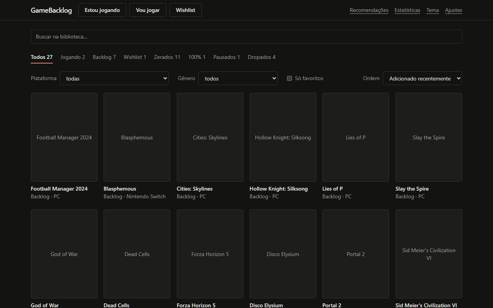
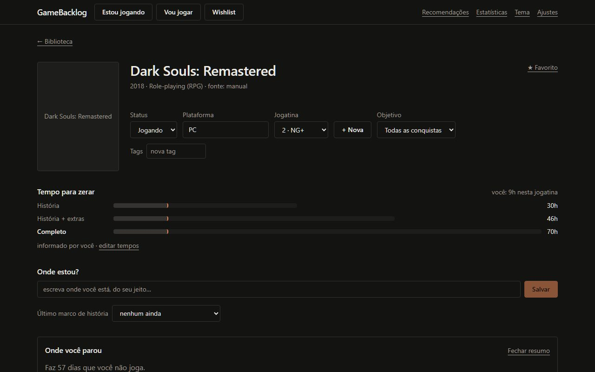
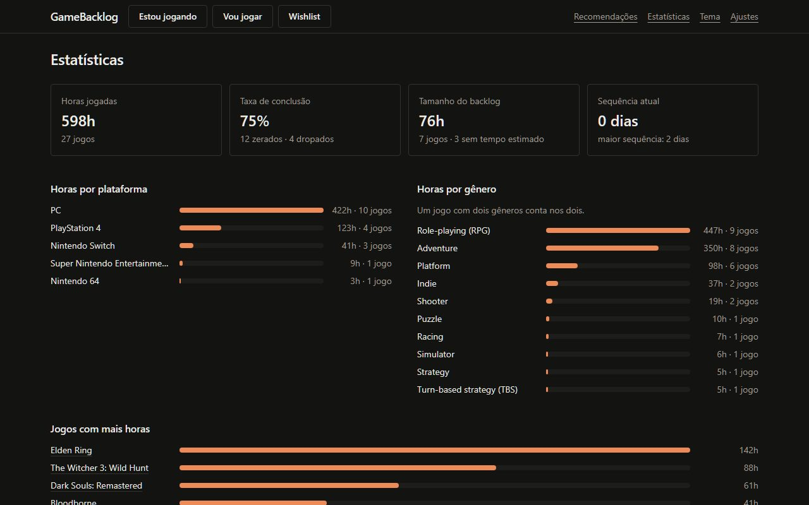

# GameBacklog

[🇧🇷 Português](README.md) · 🇬🇧 English

An **open source, local-first** app to look after your life as a player: what you finished,
what you are playing, your backlog and wishlist, with reviews, HowLongToBeat times,
achievements and trophies, spoiler-free hints, 100% guides, recommendations and statistics.

It runs entirely on your computer. No account, no login, no server of ours: your data lives in
a SQLite file on your machine. The interface is in Brazilian Portuguese by default and can be
switched to English in Settings.



## What it does

- **Library** as a grid of covers, with statuses (playing, backlog, wishlist, finished, 100%,
  paused, dropped), filters, tags and favourites.
- **Playthroughs**: several per game (first run, NG+, NG++), each with its own goal, hours and
  review with sub-scores.
- **Connected accounts**: imports your library from **Steam**, **PlayStation** and **Xbox**,
  and syncs achievements and trophies. Retro games sync with **RetroAchievements**.
- **Abandonment funnel**: "of those who got where you are, about X% finished" and how many
  hours are left.
- **With AI (optional)**: chapter map, free-text "Where am I?", hints on four spoiler-safe
  levels, collectibles and missables per area, with a warning before a point of no return.
- **Speak instead of typing**: a microphone beside "Where am I?", hints, diary and review. It
  uses the browser's recognition or, to keep the audio on your PC, Whisper running in the
  browser itself (about 80 MB downloaded the first time). Choose in Settings › Voice.
- **Wiki maps**: the game's interactive map (from Fandom and wiki.gg wikis, such as Elden Ring's),
  with search, filters and "you are here", plus map images and videos of the area.
- **Game route**: the areas, the paths out of each and what opens them. "Where am I?" understands
  "I finished X and Y, I'm at Z" and, with AI, warns what each path could make you miss
  (achievements, items, characters).
- **Recommendations** computed on your computer: what to play now, similar to a game, similar
  to a platinum, from your favourite genre.
- **Statistics**: hours by platform, genre and game, games finished per year, backlog size in
  hours, session streaks.
- **Export and import** everything as JSON, with an automatic daily backup.

Everything above works **without AI**, except the items marked "with AI". Where the AI comes
in, it only organizes and writes from data the app already fetched; repeated requests come from
the cache and cost zero tokens.




## Installing

You need:

- [Node.js](https://nodejs.org) 22.18 or newer;
- [pnpm](https://pnpm.io/installation) 10 or newer.

```bash
git clone https://github.com/EduardoBolize/gamebacklog.git
cd gamebacklog
pnpm install
pnpm build
pnpm start
```

Open <http://127.0.0.1:3777>. The first time, the app shows a setup guide; you can skip all of
it and configure things later in **Settings**.

For development, `pnpm dev` serves the app at <http://127.0.0.1:5173> with live reload.

## Setting up the sources

Every key is yours, is kept in the operating system's keychain and never goes into the export
file. Everything is optional: with no key at all you can still add games by hand.

| Source                | What for                                   | How to get it                                                    |
| --------------------- | ------------------------------------------ | ---------------------------------------------------------------- |
| **IGDB**              | Game search, covers, genres, similar games | Free Twitch credential (steps below)                             |
| **Steam**             | Import library, hours and achievements     | Key at `steamcommunity.com/dev/apikey` and your 17-digit SteamID |
| **PlayStation**       | Import PS4/PS5 games and trophies          | NPSSO token of your session (unofficial; see the notice)         |
| **Xbox**              | Import games and achievements              | Free OpenXBL key (`xbl.io`)                                      |
| **RetroAchievements** | Achievements of retro games                | Username and API key at `retroachievements.org`, under Settings  |
| **HowLongToBeat**     | Times to beat                              | Nothing; it is on by default                                     |
| **Web search**        | Finding the game's wiki and videos         | Your own SearXNG, Brave Search API or Tavily                     |
| **RAWG**              | Reserved                                   | The key can be stored, but is not used yet                       |

### IGDB (about 3 minutes)

1. Go to `dev.twitch.tv/console` with a Twitch account that has two-factor authentication on.
2. Click "Register Your Application".
3. Name: anything. OAuth Redirect URL: `http://localhost`. Category: Application Integration.
   Client Type: Confidential.
4. Open the application you created and copy the **Client ID**.
5. Click "New Secret" and copy the **Client Secret**.
6. Paste both in Settings › Sources › IGDB.

### Steam

1. Key: go to `steamcommunity.com/dev/apikey`, enter any domain (for example `localhost`) and
   copy the key.
2. SteamID: in Steam, open "Account details"; it is the 17-digit number under the account name.
3. Under Edit Profile › Privacy Settings, set "Game details" to public.

### PlayStation

> **Notice.** Sony offers no public API. The app uses the same addresses as the official app,
> with a token from your own session. It is an unofficial path, outside Sony's terms, and may
> stop working at any time. The app only reads data.

1. In your browser, sign in to your account at `playstation.com`.
2. In the same browser, open `ca.account.sony.com/api/v1/ssocookie`.
3. Copy the 64-character code shown under `npsso` and paste it in Settings › Sources ›
   PlayStation.

The token lasts about two months. When the connection test fails, repeat the steps.

### Xbox

> **Notice.** Microsoft does not open this API to third parties. The app uses OpenXBL, a free
> third-party service: your Xbox data passes through their servers. The free plan allows 150
> requests an hour.

1. Go to `xbl.io` and sign in with your Microsoft account.
2. Copy the API key from the dashboard and paste it in Settings › Sources › Xbox.

## Connecting an AI

In Settings › AI you pick **one** of these. They all do the same things.

| Way                                                           | Cost                   | What it needs                                   |
| ------------------------------------------------------------- | ---------------------- | ----------------------------------------------- |
| **Claude Code**, **Codex** or **Gemini** (CLI)                | Uses your subscription | The CLI installed and logged in on the computer |
| **Anthropic**, **OpenAI**, **Google** or **OpenRouter** (API) | Pay per use            | An API key                                      |
| **Ollama** or **LM Studio** (local)                           | Free                   | The model server running on your machine        |

After setting it up, click **Test connection** and **Use this one**. The **AI usage** screen
lists every request made, the tokens, and what came from the cache.

## FAQ

**Where is my data?**
In a `gamebacklog.sqlite` file in the system's data folder: `%APPDATA%\GameBacklog` on Windows,
`~/Library/Application Support/GameBacklog` on macOS and `~/.local/share/GameBacklog` on Linux.
To use another folder, set `GAMEBACKLOG_DATA_DIR` in a `.env` file (see `.env.example`).

**How do I back up?**
In Settings, "Export everything as JSON" writes a file with the whole library, without the
keys. So you do not have to remember, turn on the automatic daily backup and pick a folder. To
restore, use "Import" on the same screen: you can replace everything or merge with what is
already there, with a preview before confirming.

**Is my CLI billing the API instead of using my subscription?**
That happens when an environment variable holds an API key (`ANTHROPIC_API_KEY`,
`OPENAI_API_KEY`, `GEMINI_API_KEY`…): the CLI then bills per use. The app warns in Settings ›
AI when it finds one of those variables. Remove the variable and restart the app.

**What language are the hints in?**
The language of the interface. Names of places, items and bosses stay as the game writes them,
so you can recognise them on screen.

**The PlayStation test started failing.**
The NPSSO token expired. Repeat the steps in the PlayStation section to get a new one.

**Can I use it offline?**
Yes, for everything already saved: library, diary, reviews, statistics, and recommendations
from your own library. Searching for new games, syncing accounts and asking for hints need the
internet.

## Technologies

The code is all TypeScript (which is why GitHub shows almost only that language: the React
components are `.tsx` files, counted as TypeScript).

| Part              | What it uses                                                                                                  |
| ----------------- | ------------------------------------------------------------------------------------------------------------- |
| Interface         | React 19, Vite, Tailwind CSS 4, TanStack Query; voice with the Web Speech API or Whisper (Transformers.js)    |
| Server            | Node.js 22+ (runs TypeScript directly), Fastify 5                                                             |
| Data              | SQLite with Drizzle ORM and better-sqlite3; keys in the OS keychain                                           |
| Contracts         | Zod, shared by interface and server                                                                           |
| AI (optional)     | CLIs (Claude Code, Codex, Gemini), Vercel AI SDK, Ollama/LM Studio                                            |
| Data sources      | IGDB, Steam, PlayStation, Xbox (OpenXBL), RetroAchievements, HowLongToBeat, MediaWiki wikis (Fandom, wiki.gg) |
| Tests and quality | Vitest, Playwright, ESLint, Prettier                                                                          |
| Layout            | Monorepo with pnpm workspaces                                                                                 |

## Development

| Command                                        | What it does                                              |
| ---------------------------------------------- | --------------------------------------------------------- |
| `pnpm dev`                                     | Serves web and server with live reload                    |
| `pnpm test`                                    | Unit and integration tests (Vitest)                       |
| `pnpm test:e2e`                                | End-to-end tests (Playwright), on a throwaway data folder |
| `pnpm typecheck` / `pnpm lint` / `pnpm format` | Type, lint and formatting checks                          |
| `pnpm db:seed`                                 | Inserts an example library                                |

Architecture and conventions are in [CLAUDE.md](CLAUDE.md) (in Portuguese).

## License

[MIT](LICENSE) © Eduardo Bolize.

Game data comes from the sources you connect and belongs to them. The app always shows where
each piece of data came from and links to the source; it does not copy guides or whole texts.
