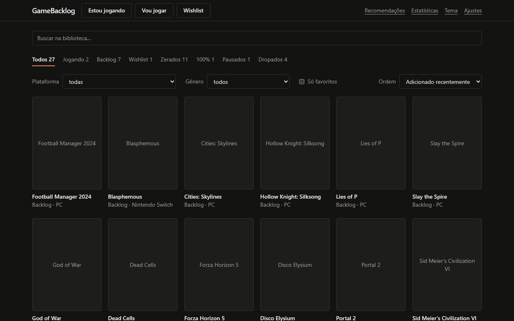
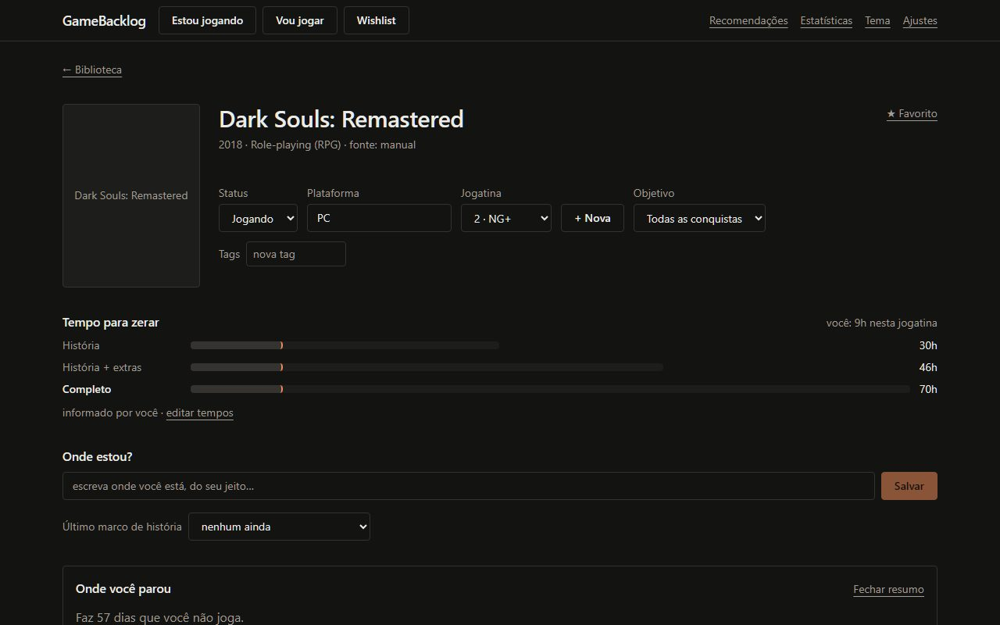
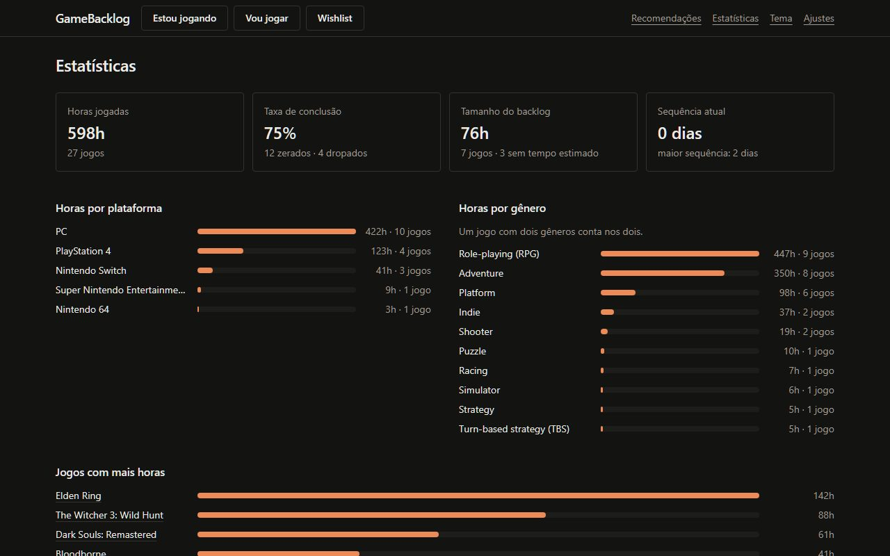

# GameBacklog

🇧🇷 Português · [🇬🇧 English](README.en.md)

Um app **open source e local-first** para cuidar da sua vida de jogadora ou jogador: o que você
zerou, o que está jogando, o backlog e a wishlist, com reviews, tempos do HowLongToBeat,
conquistas e troféus, dicas sem spoiler, guias de 100%, recomendações e estatísticas.

Roda inteiro no seu computador. Não tem conta, não tem login e não tem servidor nosso: seus
dados ficam num arquivo SQLite na sua máquina.



## O que ele faz

- **Biblioteca** em grade de capas, com status (jogando, backlog, wishlist, zerado, 100%,
  pausado, dropado), filtros, tags e favoritos.
- **Jogatinas**: várias por jogo (primeira vez, NG+, NG++), cada uma com objetivo, horas e
  review própria com subnotas.
- **Contas conectadas**: importa sua biblioteca da **Steam**, da **PlayStation** e do **Xbox**,
  e sincroniza conquistas e troféus. Jogos retrô sincronizam com o **RetroAchievements**.
- **Funil de abandono**: "de quem chegou onde você está, cerca de X% zerou" e quantas horas
  faltam.
- **Com IA (opcional)**: mapa de capítulos, "Onde estou?" em texto livre, dicas em quatro
  níveis sem spoiler, lista de colecionáveis e perdíveis por área, com aviso antes de um ponto
  sem volta.
- **Falar em vez de escrever**: um microfone ao lado de "Onde estou?", das dicas, do diário e da
  review. Usa o reconhecimento do navegador ou, para o áudio não sair do PC, o Whisper rodando
  no próprio navegador (baixa uns 80 MB na primeira vez). Escolha em Ajustes › Voz.
- **Mapas da wiki**: o mapa interativo do jogo (das wikis da Fandom e do wiki.gg, como o do
  Elden Ring), com busca, filtros e "você está aqui", mais as imagens de mapa e vídeos da área.
- **Rota do jogo**: as áreas, com os caminhos de cada uma e o que abre cada caminho. "Onde estou?"
  entende frases como "terminei X e Y, estou em Z" e, com IA, avisa o que você pode perder em
  cada caminho (conquistas, itens, personagens).
- **Recomendações** calculadas no seu computador: o que jogar agora, parecidos com um jogo,
  parecidos com uma platina, do seu gênero favorito.
- **Estatísticas**: horas por plataforma, gênero e jogo, zerados por ano, tamanho do backlog
  em horas, sequências de sessões.
- **Exportar e importar** tudo em JSON, com backup automático diário.

Tudo acima funciona **sem IA**, menos os itens marcados "com IA". Onde a IA entra, ela só
organiza e escreve a partir de dados que o app já buscou; pedidos repetidos vêm do cache e
gastam zero tokens.




## Instalação

Você precisa de:

- [Node.js](https://nodejs.org) 22.18 ou mais novo;
- [pnpm](https://pnpm.io/installation) 10 ou mais novo.

```bash
git clone https://github.com/EduardoBolize/gamebacklog.git
cd gamebacklog
pnpm install
pnpm build
pnpm start
```

Abra <http://127.0.0.1:3777>. Na primeira vez o app mostra um guia de configuração; dá para
pular tudo e configurar depois em **Ajustes**.

Para desenvolver, `pnpm dev` sobe o app em <http://127.0.0.1:5173> com recarga automática.

## Configurando as fontes

Todas as chaves são suas, ficam guardadas no cofre de senhas do sistema operacional e nunca
entram no arquivo de exportação. Tudo é opcional: sem nenhuma chave você ainda pode adicionar
jogos à mão.

| Fonte                 | Para quê                                        | Como conseguir                                                       |
| --------------------- | ----------------------------------------------- | -------------------------------------------------------------------- |
| **IGDB**              | Busca de jogos, capas, gêneros, jogos parecidos | Credencial gratuita da Twitch (passo a passo abaixo)                 |
| **Steam**             | Importar biblioteca, horas e conquistas         | Chave em `steamcommunity.com/dev/apikey` e seu SteamID de 17 dígitos |
| **PlayStation**       | Importar jogos de PS4/PS5 e troféus             | Token NPSSO da sua sessão (não oficial; veja o aviso)                |
| **Xbox**              | Importar jogos e conquistas                     | Chave gratuita do OpenXBL (`xbl.io`)                                 |
| **RetroAchievements** | Conquistas de jogos retrô                       | Usuário e chave da API em `retroachievements.org`, em Settings       |
| **HowLongToBeat**     | Tempos para zerar                               | Nada; já vem ligado                                                  |
| **Busca web**         | Achar a wiki do jogo e vídeos                   | SearXNG próprio, Brave Search API ou Tavily                          |
| **RAWG**              | Reservado                                       | A chave pode ser guardada, mas ainda não é usada                     |

### IGDB (cerca de 3 minutos)

1. Entre em `dev.twitch.tv/console` com uma conta da Twitch que tenha verificação em duas
   etapas ligada.
2. Clique em "Registrar seu aplicativo".
3. Nome: qualquer um. URL de redirecionamento OAuth: `http://localhost`. Categoria:
   Application Integration. Tipo de cliente: Confidencial.
4. Abra o aplicativo criado e copie o **Client ID**.
5. Clique em "Novo segredo" e copie o **Client Secret**.
6. Cole os dois em Ajustes › Fontes › IGDB.

### Steam

1. Chave: entre em `steamcommunity.com/dev/apikey`, informe qualquer domínio (por exemplo
   `localhost`) e copie a chave.
2. SteamID: na Steam, abra "Detalhes da conta"; é o número de 17 dígitos abaixo do nome.
3. Em Editar perfil › Configurações de privacidade, deixe "Detalhes dos jogos" como público.

### PlayStation

> **Aviso.** A Sony não oferece API pública. O app usa os mesmos endereços do aplicativo
> oficial, com um token da sua própria sessão. É um caminho não oficial, fora dos termos da
> Sony, e pode parar de funcionar a qualquer momento. O app só lê dados.

1. No navegador, entre na sua conta em `playstation.com`.
2. No mesmo navegador, abra `ca.account.sony.com/api/v1/ssocookie`.
3. Copie o código de 64 caracteres que aparece em `npsso` e cole em Ajustes › Fontes ›
   PlayStation.

O token vale cerca de dois meses. Quando o teste de conexão falhar, repita os passos.

### Xbox

> **Aviso.** A Microsoft não abre essa API a terceiros. O app usa o OpenXBL, um serviço
> gratuito de terceiros: seus dados do Xbox passam pelos servidores deles. O plano gratuito
> permite 150 consultas por hora.

1. Entre em `xbl.io` e faça login com a sua conta Microsoft.
2. Copie a chave de API no painel e cole em Ajustes › Fontes › Xbox.

## Conectando uma IA

Em Ajustes › IA você escolhe **uma** destas formas. Todas fazem as mesmas coisas.

| Forma                                                         | Custo                | O que precisa                                |
| ------------------------------------------------------------- | -------------------- | -------------------------------------------- |
| **Claude Code**, **Codex** ou **Gemini** (CLI)                | Usa a sua assinatura | A CLI instalada e logada no computador       |
| **Anthropic**, **OpenAI**, **Google** ou **OpenRouter** (API) | Pago por uso         | Uma chave de API                             |
| **Ollama** ou **LM Studio** (local)                           | Grátis               | O servidor de modelos rodando na sua máquina |

Depois de configurar, clique em **Testar conexão** e em **Usar esta**. A tela **Uso de IA**
mostra cada pedido feito, os tokens e o que veio do cache.

## Perguntas frequentes

**Onde ficam os meus dados?**
Num arquivo `gamebacklog.sqlite` na pasta de dados do sistema: `%APPDATA%\GameBacklog` no
Windows, `~/Library/Application Support/GameBacklog` no macOS e `~/.local/share/GameBacklog`
no Linux. Para usar outra pasta, defina `GAMEBACKLOG_DATA_DIR` num arquivo `.env` (veja
`.env.example`).

**Como faço backup?**
Em Ajustes, "Exportar tudo em JSON" gera um arquivo com a biblioteca inteira, sem as chaves.
Para não depender de lembrar, ligue o backup automático diário e escolha uma pasta. Para
restaurar, use "Importar" na mesma tela: dá para substituir tudo ou mesclar com o que já
existe, com uma prévia antes de confirmar.

**Minha CLI está cobrando por API em vez de usar a assinatura?**
Isso acontece quando existe uma variável de ambiente com chave de API (`ANTHROPIC_API_KEY`,
`OPENAI_API_KEY`, `GEMINI_API_KEY`…): a CLI passa a cobrar por uso. O app avisa em Ajustes ›
IA quando encontra uma dessas variáveis. Remova a variável e reinicie o app.

**As dicas vêm em que idioma?**
No idioma da interface. Nomes de lugares, itens e chefes ficam como o jogo escreve, para você
reconhecer na tela.

**O teste da PlayStation começou a falhar.**
O token NPSSO expirou. Repita os passos da seção PlayStation para pegar um novo.

**Posso usar sem internet?**
Sim, para tudo o que já está salvo: biblioteca, diário, reviews, estatísticas e recomendações
a partir da sua biblioteca. Buscar jogos novos, sincronizar contas e pedir dicas precisam de
internet.

## Tecnologias

O código é todo em TypeScript (por isso o GitHub mostra quase só essa linguagem: os
componentes React são arquivos `.tsx`, que contam como TypeScript).

| Parte              | O que usa                                                                                                     |
| ------------------ | ------------------------------------------------------------------------------------------------------------- |
| Interface          | React 19, Vite, Tailwind CSS 4, TanStack Query; voz com Web Speech API ou Whisper (Transformers.js)           |
| Servidor           | Node.js 22+ (executa TypeScript direto), Fastify 5                                                            |
| Dados              | SQLite com Drizzle ORM e better-sqlite3; chaves no cofre do SO                                                |
| Contratos          | Zod, compartilhado entre interface e servidor                                                                 |
| IA (opcional)      | CLIs (Claude Code, Codex, Gemini), Vercel AI SDK, Ollama/LM Studio                                            |
| Fontes de dados    | IGDB, Steam, PlayStation, Xbox (OpenXBL), RetroAchievements, HowLongToBeat, wikis MediaWiki (Fandom, wiki.gg) |
| Testes e qualidade | Vitest, Playwright, ESLint, Prettier                                                                          |
| Organização        | Monorepo com pnpm workspaces                                                                                  |

## Desenvolvimento

| Comando                                        | O que faz                                                             |
| ---------------------------------------------- | --------------------------------------------------------------------- |
| `pnpm dev`                                     | Sobe o web e o server com recarga automática                          |
| `pnpm test`                                    | Testes unitários e de integração (Vitest)                             |
| `pnpm test:e2e`                                | Testes de ponta a ponta (Playwright), numa pasta de dados descartável |
| `pnpm typecheck` / `pnpm lint` / `pnpm format` | Verificações de tipo, lint e formatação                               |
| `pnpm db:seed`                                 | Insere uma biblioteca de exemplo                                      |

A arquitetura e as convenções estão em [CLAUDE.md](CLAUDE.md).

## Licença

[MIT](LICENSE) © Eduardo Bolize.

Os dados de jogos vêm das fontes que você conectar e pertencem a elas. O app sempre mostra de
onde cada dado veio e linka a fonte; não copia guias nem textos inteiros.
